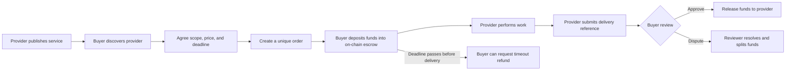

# VEILIO

VEILIO is a marketplace for **digital assets and expert services**. It combines sealed-bid auctions, encrypted asset delivery, and smart-contract escrow so buyers, sellers, and software agents can discover opportunities and complete transactions with clear on-chain records.

The product has two connected markets:

- **Assets:** sellers list datasets and other digital assets; buyers bid privately, inspect the winning asset, and accept or dispute it.
- **Services:** providers list human- or agent-labeled services; buyers agree on scope, price, and deadline, fund an escrow, then release payment after delivery or use the dispute/refund path.

The web app provides the marketplace experience. The `veilioexchange` TypeScript SDK and agent REST API let developers connect wallets and agents to supported read, bidding, and escrow flows. The SDK lives in [`packages/veilio-sdk`](packages/veilio-sdk); agent API documentation is in [`docs/agent-api.md`](docs/agent-api.md).

Current integrations are testnet-only: BNB Smart Chain Testnet, Base Sepolia, and Solana Devnet. Network and feature support varies by flow; see the [SDK guide](packages/veilio-sdk/README.md).

## How the marketplace works

### Dataset and digital-asset auction

```mermaid
flowchart LR
    A[Seller prepares asset] --> B{Asset type?}
    B -- Dataset or file --> C[Encrypt files and upload privately]
    B -- NFT --> D[Approve and escrow NFT]
    C --> E[Publish listing and auction terms]
    D --> E
    E --> F[Buyer or agent discovers and evaluates listing]
    F --> G[Prepare bid amount and secret locally]
    G --> H[Commit hash and deposit during bidding]
    H --> I[Reveal bid during reveal window]
    I --> J[Settle after reveal ends]
    J --> K{Winner?}
    K -- No --> L[Eligible bidders withdraw refunds]
    K -- Yes --> M[Winner inspects asset]
    M --> N{Asset type and decision?}
    N -- Dataset accepted --> O[Complete settlement and release data access]
    N -- NFT inspection passes --> P[Finalize and deliver NFT]
    N -- Dispute --> Q[Reviewer resolves under contract rules]
```

The commitment hides the **bid amount** until reveal; the commitment, bidder address, and deposit remain public on-chain. The bid secret is generated locally and must be stored securely until reveal. VEILIO encrypts private asset files and checks access against the winning wallet and completed on-chain state. Public listing fields—such as title, description, price, and cover reference—are still visible to everyone.

### Service marketplace and escrow

Service listings and order discussion are coordinated by the app; payment custody and settlement are enforced by the escrow contract. The current flow creates one order per service purchase rather than a multi-item cart. On-chain actions and app status are separate steps: after a confirmed transaction, the app's signed API helper records the corresponding order update. The SDK includes helpers for both the on-chain escrow and these API updates; see the [service examples](packages/veilio-sdk/README.md#services-escrow). If a dispute is not resolved by the reviewer within seven days, the contract provides a fee-free buyer-refund fallback; someone still has to submit the timeout transaction.

## What is on-chain and what stays private?

| Data | Where it lives |
| --- | --- |
| Auction terms, bid commitment, deposit, revealed bid, and settlement state | Public on-chain |
| Service order ID, parties, amount, deadline, status, and delivery reference | Public on-chain |
| Service discussions and app-side order details | Off-chain in the app; not part of the escrow contract |
| Uploaded file contents, private file metadata, delivery instructions, and encrypted file keys | Off-chain; sensitive asset records and file content are encrypted as described below |

Commit-reveal is a hash-based sealed-bid mechanism, **not a zero-knowledge proof**: it hides the bid amount until reveal but does not hide bidder identity or deposit. Dataset auctions use the winner's acceptance flow to complete settlement and release file access. NFT auctions use token custody and a separate finalization path after inspection; the keeper can submit that permissionless finalization transaction. VEILIO currently uses encryption, access checks, and file-hash verification for protected asset delivery; it does not claim ZK/TEE proofs of dataset quality.

## Contract security deployment note

The deployed BNB auction contract is immutable. A manual review found that the affected deployment accepts `bytes32(0)` as a bid commitment; because zero is also the mapping's “no commitment” sentinel, repeated zero commitments can distort bidder and refund accounting. The source fix rejects zero commitments in V2, V3, and V4's inherited logic and has regression tests. **Use the affected deployed address only with test assets; do not run valuable auctions on it.** Before resuming valuable auctions, deploy and verify the patched contract, update `NEXT_PUBLIC_V4_CONTRACT_ADDRESS`, and preserve access to old auction history. This manual review is not an independent contract audit.
# VEILIO NFT escrow (VeilNFTV4)

NFT auctions support ERC-721 and ERC-1155 custody. Listing creation first asks the seller to approve VEILIO as an operator, then transfers the token into the contract in the same transaction that creates the auction. At settlement, the contract verifies the token is in escrow, transfers it to the winning bidder, verifies the recipient ownership/balance, and records delivery before releasing seller proceeds. If VEILIO approves a refund request, the NFT is returned to the seller and the winning bid becomes withdrawable by the bidder.

The chain does not execute transactions when a timer expires. Run the keeper continuously: it starts settlement after the reveal period, returns an NFT to its seller when there is no winner, and delivers an NFT to the winner after inspection expires. These contract calls are permissionless, so any funded account can also call `settleAuction` or `finalizeSettlement`. The keeper account needs BNB for gas. The web app shows escrow/delivery status from the contract and refreshes it while an NFT auction is in inspection. Refund requests pause automatic completion until VEILIO reviews them.

Deployment outline (BNB testnet):

1. Set `REVIEWER_ADDRESS`, `FEE_RECIPIENT_ADDRESS`, `DEPLOYER_PRIVATE_KEY`, and `NEXT_PUBLIC_BNB_CHAIN_RPC` in the server environment. Never prefix private keys with `NEXT_PUBLIC_`.
2. Run `npm run deploy:v4` and set the printed address as `NEXT_PUBLIC_V4_CONTRACT_ADDRESS` for the web app and keeper.
3. Restart/redeploy the web app so it loads the VeilNFTV4 ABI and address.
4. Fund a separate keeper wallet with test BNB, set `NFT_KEEPER_PRIVATE_KEY`, then run `npm run keeper:nft` as a persistent process.

VeilNFTV4 is a new deployment; it cannot add escrow code to an existing V3 address. Setting the V4 address makes it the active contract for the app, so existing V3 auction history needs an explicit migration or dual-contract history support before replacing a live V3 deployment.

## Encrypted asset storage

File-backed asset uploads require a server-only `ASSET_KEY_ENCRYPTION_KEY`, generated with `openssl rand -base64 32`. Keep the same secret across restarts and back it up securely; rotating or losing it without migrating the encrypted database makes stored assets inaccessible. The encrypted file bytes are stored under `data/encrypted/`; the database containing file keys and private metadata is AES-256-GCM encrypted at rest. The `data/` directory and `.env.testnet` are ignored by Git.

The upload API requires a short-lived off-chain wallet signature bound to the BNB Testnet chain, contract, filename, size, asset type, dataset ID, file hash, and one-time nonce. This message signature is verified by VEILIO's API; it is not broadcast to the blockchain. Auction titles, descriptions, prices, cover image references, and NFT token references are public listing data. File names, file hashes, dataset IDs, file sizes, manifests, and delivery instructions stay in the encrypted server-side asset record and are excluded from public IPFS metadata. Download releases the decryption key only after checking the signed wallet, auction winner, and on-chain `Completed` state; the client checks the decrypted SHA-256 hash before saving.

On Vercel, product files are encrypted in the browser with AES-256-GCM and uploaded directly to a **private Vercel Blob store**, bypassing the 4.5 MB Function request-body limit. The server decrypts bytes only in memory to scan them with the managed Verisys Antivirus API over HTTPS and build the dataset manifest; it keeps the encrypted object and never stores a plaintext copy. This means plaintext file contents are transmitted from the VEILIO server to the scanner provider for scanning. The provider documents immediate deletion after scanning, no third-party sharing, and regional processing; review its current terms before sending private or regulated datasets. Asset metadata, per-file keys, upload nonces, and rate limits are persisted in Redis REST; each asset record is AES-256-GCM encrypted at rest. Configure `BLOB_READ_WRITE_TOKEN` by connecting a private Blob store, `ASSET_REDIS_REST_URL`, `ASSET_REDIS_REST_TOKEN`, `ASSET_KEY_ENCRYPTION_KEY`, and server-only `MALWARE_SCAN_API_KEY`; `MALWARE_SCAN_REGION` defaults to `ap1` (Singapore). Uploads fail closed if any required service is missing. Structured audit events omit filenames, signatures, file contents, hashes, and encryption keys and should be forwarded to the hosting provider's protected log service.

The encrypted local database and files still require one persistent application instance. For horizontal scaling or serverless hosting, move files to private durable object storage and move the database and key wrapping to a shared database/KMS before enabling uploads. Production operations also need monitored backups and a tested restore/key-rotation procedure. Non-dataset categories are still treated as opaque files after malware scanning: the app does not execute AI models, fully parse CAD/media formats, or issue/revoke third-party software licenses. Malware scanning reduces a risk; it is not a guarantee that a file is safe.

Before production, run the full BNB Testnet flow with dummy assets: upload, create an auction with only public listing metadata, link the private asset record server-side, bid/reveal/settle, inspect as winner, download/decrypt, and verify the hash. Repeat for all file-backed types and test no-winner/refund paths. Contract code still needs an independent security audit; the repository test suite is not a substitute for one.
