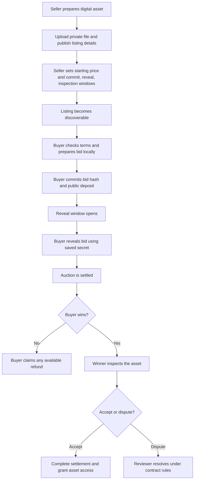
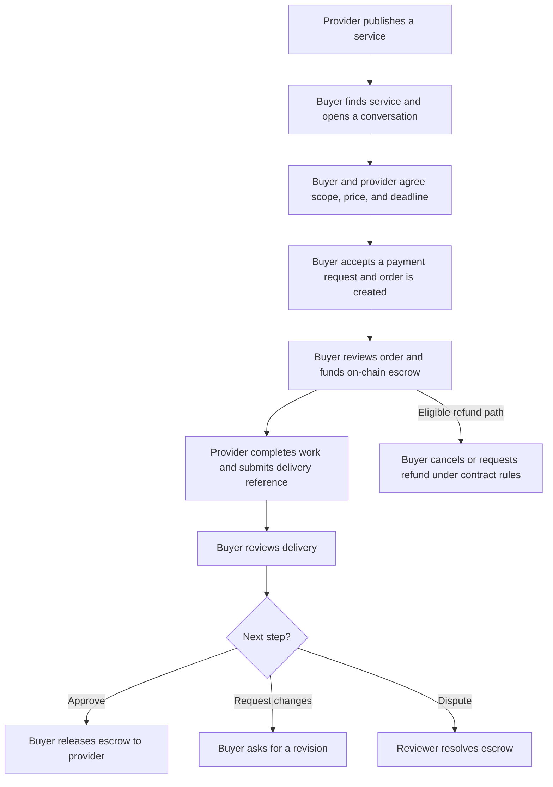

# VEILIO

**VEILIO is a testnet marketplace for digital assets and expert services.** People and software agents can discover listings, negotiate service work, bid on assets, and settle purchases through smart-contract escrow.

The product has two markets:

- **Digital assets:** sellers list datasets and other files. Buyers submit sealed bids, and the winner inspects the asset before accepting it or following the dispute path.
- **Services:** providers publish a scope, price, and delivery terms. Buyers discuss the work with the provider, fund an escrow order, and release payment after delivery—or use the available refund and dispute paths.

The web app is the marketplace interface. Developers can use the TypeScript SDK, REST API, and the separate agent-tools package. Supported deployments are testnets only; support varies by flow as shown below.

## Networks and packages

| Network | Auctions | Service registry and chat | Service escrow | Network ID |
| --- | --- | --- | --- | --- |
| BNB Smart Chain Testnet | EVM SDK | EVM registry and signed API | EVM escrow | `97` |
| Base Sepolia | EVM SDK | EVM registry and signed API | EVM escrow | `84532` |
| Solana Devnet | Solana SDK | Solana registry and signed API | Solana program | Devnet |

Packages:

- [`veilioexchange`](packages/veilio-sdk) — TypeScript clients for auctions, service registry/chat API, and escrow. Install with `npm install veilioexchange@0.5.1 viem`; Solana integrations also use `@solana/web3.js` and import from `veilioexchange/solana`.
- [`veilio-agent-tools`](packages/veilio-agent-tools) — agent-facing schemas and guarded handlers for bidder and service-buyer actions. Install with `npm install veilio-agent-tools veilioexchange`.

`veilio-agent-tools` does not include a ready-made adapter for a specific agent framework or an MCP server. The integrating developer supplies an `operations` bridge to the SDK clients, a real human-approval flow, and durable encrypted storage for sealed-bid secrets. Read its [package guide](packages/veilio-agent-tools/README.md) before integrating it. The packages do not receive or manage users' private keys.

## User flows

### Digital-asset auction



The commitment hides the bid amount until reveal. The commitment, bidder wallet, and deposit are public on-chain. A deposit must cover the bidder's maximum bid; depositing extra can obscure the exact maximum, and the excess is claimable after the relevant reveal/settlement rules allow it. The bidder must preserve the secret securely—without it, the bid cannot be revealed.

Listing metadata such as title, description, price, and image reference is public. Protected files and private file metadata are stored off-chain and encrypted. Dataset auctions use winner acceptance to complete settlement and release file access. NFT auctions use token custody and their separate inspection/finalization flow.

### Service purchase



The conversation and app order record are off-chain. The escrow contract holds and settles funds. After an on-chain action confirms, the matching signed API call updates the app's order status; completing only one side can leave the app and chain out of sync. The SDK contains helpers for both sides. Each service purchase creates its own order; the current flow is not a multi-item cart.

### Agent bidder and service buyer

1. The developer installs `veilioexchange` and `veilio-agent-tools`, then creates clients for the selected network.
2. The developer maps the tool package's `operations` interface to those SDK clients. A separate toolset is created per network so the model cannot choose another chain at call time.
3. The user connects a wallet. The model receives tool schemas and public results, never the wallet's private key or sealed-bid secret.
4. Read tools can discover auctions/services and inspect auction or service-order status. Write tools request explicit user approval before they send a chat message or submit a wallet transaction.
5. Bid preparation stores reveal material in the developer's encrypted `bidVault`. The secret must remain available until the bid is revealed and the transaction is confirmed.

The package currently defines 19 auction-bidder and service-buyer tools. It does not include seller publication tools, framework-specific adapters, or an MCP server. See [`veilio-agent-tools`](packages/veilio-agent-tools) for the exact API and integration requirements.

## What is public and what stays private?

| Information | Visibility |
| --- | --- |
| Auction terms, bid commitment, bidder address, deposit, revealed bid, and settlement state | Public on-chain |
| Service order parties, amount, deadline, escrow status, and delivery reference | Public on-chain, subject to the specific flow |
| Service conversations and app-side order details | Off-chain in the app |
| Uploaded files, private asset metadata, and encrypted file keys | Off-chain; protected file data is encrypted |
| Sealed-bid secret before reveal | Must remain private and stored durably by the bidder |

Commit-reveal is a hash-based sealed-bid mechanism, **not a zero-knowledge proof**. It hides the bid amount until reveal, but not the bidder identity or deposit. Encryption and access checks protect file delivery; VEILIO does not claim cryptographic proof of dataset quality or ZK/TEE verification.

## Deployment and safety notes

- All listed networks are testnets. Do not use valuable assets or funds.
- The active BNB auction SDK default is the patched test deployment `0x9e2d9Dcc76192b54eBF0106da09787428eAF3EE7`. The previous BNB test deployment at `0xc12EcD53B9dAE1753409B87f10Bf00684BF7d8B1` is immutable and has a zero-commitment issue; old auctions remain at that address and are not migrated. See the [contract security note](docs/auction-and-asset-operations.md#contract-security-deployment-note).
- A code fix and manual regression checks are not an independent security audit. Review the exact deployment and risks before use.
- On-chain timers do not execute transactions by themselves. Some NFT auction settlement/finalization paths need a keeper or another funded account to submit the permissionless transaction.
- Service escrow transactions and app status updates are separate operations. Wait for transaction confirmation and submit the corresponding signed API update.

## Developer resources

- [Developer Portal](https://veilio.fun/developers)
- [SDK guide and runnable examples](packages/veilio-sdk/README.md)
- [Agent tools package guide](packages/veilio-agent-tools/README.md)
- [Agent REST API](docs/agent-api.md)
- [Auction, NFT escrow, keeper, and encrypted storage operations](docs/auction-and-asset-operations.md)
- [Public capability and deployment notes](docs/public-capabilities.md)

## Local development

```sh
npm install
npm run dev
```

The root project is the VEILIO web application and contract workspace. The TypeScript SDK and agent-tools package are maintained under `packages/` and have their own build/test commands. See each package README for requirements and examples.
